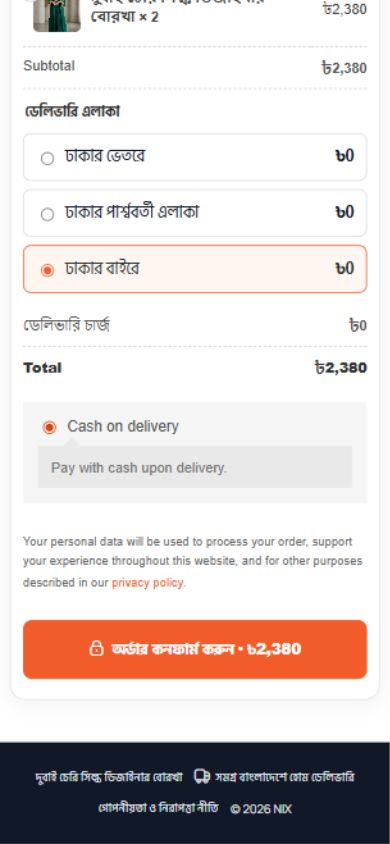

# Website security and functionality audit — 2026-10-09

Scope: local Express/MySQL API, React admin, storefront, landing checkout, visual builder, customer data boundaries, order lifecycle, dependencies and sampled desktop/mobile UI. This is a code review plus targeted runtime verification, not a guarantee that every possible condition is bug-free.

## Confirmed findings and fixes

| Finding | Impact | Resolution |
| --- | --- | --- |
| CRM list/detail/update returned full Customer records | Password hashes and sessionVersion could be disclosed to staff consumers | Prisma field allowlist for all three responses; controller regression tests and authenticated live read checks |
| Realtime order events contained entire orders; Woo import included full customer relation | Unnecessary customer, tracking and cost data disclosure | Minimal notification payload; removed Woo customer include; admin refetches authorized order data |
| Socket authorization only checked on connection | Existing sockets could survive token expiry/session revocation | Token-expiry disconnect and session/status revalidation every 30 seconds; revocation has a bounded 30-second window |
| Bulk status updates could reopen terminal orders | Stock/customer accounting could become inconsistent | Reject terminal source states and missing orders; atomically compare original states before each batch mutation |
| Delivered orders could reopen and repeated concurrent status changes could double-count | Duplicate restock/customer totals | Delivered may transition only to Returned; transaction claims original status before side effects; delivered-return reverses completed totals |
| Return stock movements recorded previous/current stock as zero | Incorrect stock history | Record actual returned product/variant stock balances |
| Order sort accepted `total` instead of the Prisma field | API 500 on sorting | Map `total` to `grandTotal` |
| Fractional public product limit passed to Prisma | Avoidable 500 errors | Integer bounded pagination |
| Missing product lookup loaded all active products and variants | Resource amplification on arbitrary requests | Legacy fallback reads only slug-less product IDs/names, then fetches a matching product |
| Malformed percent-encoded cookie could break token parsing | Session parsing failures | Ignore malformed cookie values; regression test |
| Error responses could disclose database paths/stack details in development | Information disclosure on shared local previews | Mask all 500 JSON responses, remove response stacks, return validation failures as 400 |
| Purchase tracking accepted missing consent | Customer data could be relayed without affirmative consent | Require explicit true consent |
| Meta browser event relay used encrypted token directly | Configured event relay could fail | Reveal token only inside server-side outbound call |
| Borka advertises free delivery for two pieces but charged delivery | Incorrect checkout total | Editable `freeDeliveryMinQuantity` checkout setting shared by UI/server logic; Borka live and draft set to 2, with private pre-change backup |
| Production dependency advisories in server/admin | Known library vulnerabilities | Compatible npm audit fixes and updated lockfiles; all three production scans now return zero |
| Header/footer region wrapper nested another identical landmark | Invalid HTML/accessibility structure, observed on Earbuds | Use a neutral scoped wrapper when the design already supplies the header/footer landmark; renderer regression test |
| Local MySQL permission table corruption blocked application access | Landing/admin data failed to load | Backed up damaged grant-table files, repaired mysql.db, restored SELECT/INSERT/UPDATE/DELETE for existing nix_app account on its application database; subsequent application-table checks clean |

## Verification evidence

- Server, admin and storefront production builds pass.
- 72 builder tests pass, including the new duplicate-landmark regression.
- 6 new audit tests pass: CRM selections, notification redaction, cookie parsing, terminal bulk guards, stale status/restock prevention and free-delivery threshold.
- Catalog integration test passes: editable unique slugs, simple product stock retention, negative variation rejection, atomic rollback on slug collision. The intentional collision emits a Prisma log during this successful test.
- 63 live API checks pass, including 51 registered protected GET endpoints plus authenticated/public response checks. See `live-api-audit-2026-10-09.json` for exact coverage.
- 7 additional security checks pass: customer/staff token separation, revoked-session rejection, cross-origin cookie-write rejection, invalid payment token rejection, unsigned Woo webhook rejection and lower-role tracking restrictions.
- All 19 active published content/landing page API requests return 200.
- All 57 stored draft/published builder documents validate; all 14 landing links have a Thank You page.
- 42 application database tables checked with CHECK TABLE: no errors or warnings after grant-table repair.
- 217 extracted admin API calls checked against route definitions; nested submissions/generated publish routes and two concatenated URLs inspected manually. This confirms route linkage, not every endpoint's business behavior.
- `npm audit --omit=dev` returns zero vulnerabilities for server, admin and storefront.
- Mobile Borka (390px): document width 390px with no horizontal overflow; checkout border has 10px outside margins; billing inputs are 16px; no broken images; order CTA scrolls to checkout; one total in submit button; Jet Black/54 selection works; quantity 2 gives subtotal/total 2380 and delivery 0.
- Borka browser and admin login console checks show no captured errors after database recovery. Earbuds landing also inspected separately.

## Remaining limitations / follow-up items

- Development dependencies still have advisories: server nodemon/chokidar/braces (3 high); admin Tailwind 3 toolchain/braces and selector parser (5 high, 2 moderate). npm's proposed forced fixes introduce breaking upgrades/downgrades. These are not in the production dependency scans. A separate tooling migration is required rather than blindly using --force.
- Real UddoktaPay settlement, live courier booking/status callbacks, SMS/WhatsApp delivery and real Meta ingestion were not executed; external credentials, provider callbacks and actual delivery cannot be certified from local code/tests alone.
- Authenticated admin APIs were tested using short-lived locally signed tokens validated against existing users; every authenticated admin screen was not manually exercised in a browser. Login UI was checked without changing credentials.
- Native iPhone Safari zoom was not tested on hardware; 16px mobile billing input sizing and mobile layout were verified in the browser viewport.
- Existing historical stock/customer accounting was not rewritten. New lifecycle guards prevent the identified future double-count/reopen paths; reconciliation of historical business records requires business review.
- Borka still contains a placeholder hotline (`01XXXXXXXXX`) in its published design. Set the real business number in Studio.
- No production deployment, host firewall/TLS configuration, historical access-log forensics or external penetration test was performed. Finding and fixing an exposure does not establish whether it was exploited previously.

Local services left running for review: admin http://localhost:3000, storefront http://localhost:3001, API http://localhost:5000. No real customer order, payment, courier booking or outgoing message was deliberately generated by this audit.
