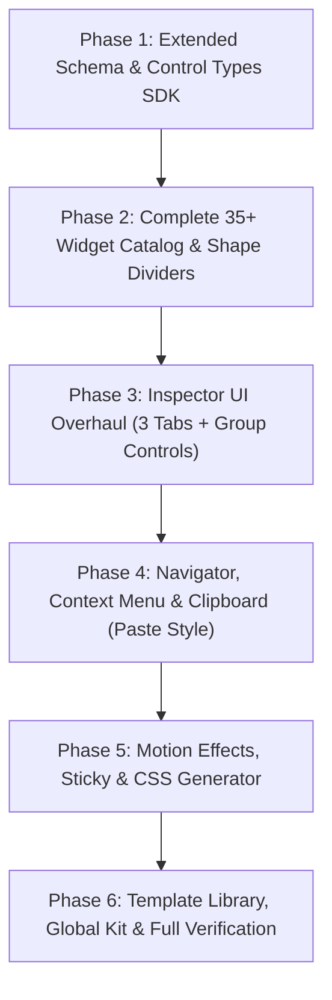

# Complete Elementor Parity Architecture & Implementation Plan
**NIX Page Builder & Studio Engine**  
*Comprehensive Blueprint for 100% Feature, Widget, Control, and Styling Parity with Elementor*

---

## 1. Executive Summary & Vision

The goal of this project is to upgrade the existing NIX Page Builder (`client/src/builder`, `server/src/modules/builder`, `storefront/src`) to achieve **100% complete feature parity with Elementor (v4.3.2)** while retaining our lightweight, fast, secure, framework-agnostic headless architecture.

Every single Elementor feature—including all **35+ base widgets**, all **12+ group controls**, all **20+ atomic control types**, **flexbox and grid container layouts**, **shape dividers**, **motion & scrolling effects**, **transforms**, **entrance animations**, **responsive cascading breakpoints**, **navigator layers tree**, **context menus & clipboard (copy/paste style)**, **global design systems**, **template library import/export**, and **e-commerce landing page conversion widgets**—is designed and mapped with full technical fidelity.

---

## 2. Core Architecture & Data Schema

### 2.1 Unified Node Data Model (`schema.ts`)
To support the full spectrum of Elementor controls and capabilities, the `BuilderNode` schema is expanded to support:
1. **Tabs Organization**: `props` (Content tab), `styles` / `responsiveStyles` / `states` (Style tab), and `advanced` (Advanced tab).
2. **Transform & Motion Effects**: 2D/3D rotations, scale, skew, offset, flip, entrance animations, sticky settings, scroll effects.
3. **Shape Dividers**: Top & bottom SVG divider configurations.
4. **Background Overlays & Gradients**: Linear, radial, video, and slideshow backgrounds.
5. **Dynamic Data Bindings**: Dynamic tags across all text, URL, media, and numerical properties.
6. **Custom Attributes & CSS**: Per-node custom selectors and HTML key-value attributes.

```typescript
export interface ResponsiveValue<T> {
  desktop: T;
  tablet?: T;
  mobile?: T;
  [breakpoint: string]: T | undefined;
}

export interface DimensionValue {
  top: number | string;
  right: number | string;
  bottom: number | string;
  left: number | string;
  unit: 'px' | '%' | 'em' | 'rem' | 'vw';
  linked: boolean;
}

export interface SliderValue {
  size: number;
  unit: 'px' | '%' | 'em' | 'rem' | 'vw' | 'vh';
}

export interface TypographyValue {
  fontFamily?: string;
  fontSize?: ResponsiveValue<SliderValue>;
  fontWeight?: string | number;
  textTransform?: 'none' | 'capitalize' | 'uppercase' | 'lowercase';
  fontStyle?: 'normal' | 'italic' | 'oblique';
  textDecoration?: 'none' | 'underline' | 'overline' | 'line-through';
  lineHeight?: ResponsiveValue<SliderValue>;
  letterSpacing?: ResponsiveValue<SliderValue>;
  wordSpacing?: ResponsiveValue<SliderValue>;
}

export interface BackgroundValue {
  type: 'classic' | 'gradient' | 'video' | 'slideshow';
  color?: string;
  image?: { url: string; id?: string };
  position?: string;
  attachment?: 'scroll' | 'fixed';
  repeat?: 'no-repeat' | 'repeat' | 'repeat-x' | 'repeat-y';
  size?: 'auto' | 'cover' | 'contain' | 'custom';
  customSize?: SliderValue;
  gradient?: {
    color1: string;
    location1: number;
    color2: string;
    location2: number;
    type: 'linear' | 'radial';
    angle: number;
    position: string;
  };
  video?: {
    url: string;
    startTime?: number;
    endTime?: number;
    playOnce?: boolean;
    fallbackImage?: string;
  };
  slideshow?: {
    images: string[];
    duration: number;
    transition: 'fade' | 'slide' | 'zoom';
    kenBurns?: boolean;
  };
}

export interface ShapeDividerValue {
  type: string; // 'waves', 'mountains', 'drops', 'clouds', 'zigzag', 'pyramids', 'triangle', 'tilt', 'curve', 'arrow', 'split', 'book'
  color: string;
  width: ResponsiveValue<SliderValue>;
  height: ResponsiveValue<SliderValue>;
  flip: boolean;
  invert: boolean;
  bringToFront: boolean;
}

export interface MotionEffectsValue {
  entranceAnimation?: string;
  animationDuration?: 'slow' | 'normal' | 'fast';
  animationDelay?: number;
  sticky?: 'none' | 'top' | 'bottom';
  stickyOn?: ('desktop' | 'tablet' | 'mobile')[];
  stickyOffset?: number;
  stickyEffectsOffset?: number;
  stayInColumn?: boolean;
  scrollingEffects?: {
    verticalScroll?: { direction: 'up' | 'down'; speed: number; viewport: [number, number] };
    horizontalScroll?: { direction: 'to-left' | 'to-right'; speed: number; viewport: [number, number] };
    transparency?: { direction: 'fade-in' | 'fade-out'; level: number; viewport: [number, number] };
    blur?: { direction: 'in' | 'out'; level: number; viewport: [number, number] };
    rotate?: { direction: 'left' | 'right'; speed: number; viewport: [number, number] };
    scale?: { direction: 'up' | 'down'; speed: number; viewport: [number, number] };
  };
  mouseEffects?: {
    mouseTrack?: { direction: 'opposite' | 'direct'; speed: number };
    tilt3D?: { direction: 'opposite' | 'direct'; speed: number };
  };
}

export interface TransformValue {
  rotate2D?: ResponsiveValue<number>;
  rotate3DX?: ResponsiveValue<number>;
  rotate3DY?: ResponsiveValue<number>;
  rotate3DZ?: ResponsiveValue<number>;
  offsetX?: ResponsiveValue<SliderValue>;
  offsetY?: ResponsiveValue<SliderValue>;
  scaleX?: ResponsiveValue<number>;
  scaleY?: ResponsiveValue<number>;
  skewX?: ResponsiveValue<number>;
  skewY?: ResponsiveValue<number>;
  flipHorizontal?: boolean;
  flipVertical?: boolean;
  transformOrigin?: string;
}

export interface AdvancedSettings {
  margin?: ResponsiveValue<DimensionValue>;
  padding?: ResponsiveValue<DimensionValue>;
  zIndex?: number;
  cssId?: string;
  cssClasses?: string[];
  motionEffects?: MotionEffectsValue;
  transform?: { normal?: TransformValue; hover?: TransformValue; transitionDuration?: number };
  background?: { normal?: BackgroundValue; hover?: BackgroundValue };
  backgroundOverlay?: { normal?: BackgroundValue; hover?: BackgroundValue; opacity?: number; blendMode?: string };
  border?: { normal?: any; hover?: any };
  mask?: { type?: string; image?: string; position?: string; repeat?: string; size?: string };
  responsiveVisibility?: { hideDesktop?: boolean; hideTablet?: boolean; hideMobile?: boolean };
  customAttributes?: Array<{ key: string; value: string }>;
  customCss?: string;
}

export interface BuilderNode {
  id: string;
  type: string;
  name: string;
  version: number;
  props: Record<string, any>;
  styles: Record<string, string>;
  responsiveStyles: Record<string, Record<string, string>>;
  states: Record<string, Record<string, string>>;
  advanced?: AdvancedSettings;
  shapeDividers?: { top?: ShapeDividerValue; bottom?: ShapeDividerValue };
  attributes: Record<string, string>;
  classes: string[];
  bindings: Record<string, string>;
  children: BuilderNode[];
  locked: boolean;
  hidden: boolean;
}
```

---

## 3. Elementor Control Types SDK Catalog

Every control in Elementor will have a 1-to-1 equivalent TypeScript definition and corresponding React UI control in the Inspector:

| Control Type | Elementor Equivalent | Description & Capabilities |
| :--- | :--- | :--- |
| `text` | `Controls_Manager::TEXT` | Single line text with dynamic tag support |
| `textarea` | `Controls_Manager::TEXTAREA` | Multi-line text field |
| `wysiwyg` | `Controls_Manager::WYSIWYG` | Rich text editor (headings, bold, italic, lists, links) |
| `number` | `Controls_Manager::NUMBER` | Numerical input with min, max, and step |
| `slider` | `Controls_Manager::SLIDER` | Range slider with unit selector (`px`, `%`, `em`, `rem`, `vw`, `vh`) & responsive toggle |
| `select` | `Controls_Manager::SELECT` | Dropdown selection |
| `select2` | `Controls_Manager::SELECT2` | Searchable multi-select dropdown |
| `choose` | `Controls_Manager::CHOOSE` | Visual button group (e.g. text alignment left/center/right/justify) |
| `switcher` | `Controls_Manager::SWITCHER` | On/Off toggle switch with return values |
| `color` | `Controls_Manager::COLOR` | Color picker with RGBA, hex, alpha slider, and global palette tokens |
| `media` | `Controls_Manager::MEDIA` | Image / video / audio picker with gallery selection, URL, and SVG support |
| `gallery` | `Controls_Manager::GALLERY` | Multiple image selection and reordering |
| `icons` | `Controls_Manager::ICONS` | FontAwesome 6 (solid/regular/brands) and SVG icon picker with search |
| `dimensions`| `Controls_Manager::DIMENSIONS` | 4-sided linked/unlinked box inputs (Top, Right, Bottom, Left) + units + responsive |
| `repeater` | `Controls_Manager::REPEATER` | Dynamic list of nested sub-items (used for tabs, accordions, icon lists, etc.) |
| `url` | `Controls_Manager::URL` | Link control with URL, open in new tab, `rel="nofollow"`, and custom attributes |
| `code` | `Controls_Manager::CODE` | Monospace code editor with syntax highlighting (HTML/CSS/JS) |
| `box_shadow`| `Group_Control_Box_Shadow` | Color, horizontal, vertical, blur, spread, outline/inset |
| `text_shadow`| `Group_Control_Text_Shadow`| Color, horizontal, vertical, blur |
| `typography`| `Group_Control_Typography` | Family, size, weight, transform, style, decoration, line-height, letter-spacing |
| `background`| `Group_Control_Background` | Classic, Gradient, Video, Slideshow with full position/repeat/size |
| `border` | `Group_Control_Border` | Type (solid/double/dotted/dashed/groove), width, color, radius |
| `css_filter`| `Group_Control_Css_Filter` | Blur, brightness, contrast, saturation, hue |
| `popover_toggle`| `Controls_Manager::POPOVER_TOGGLE` | Compact popover container for dense styling options |

---

## 4. Complete Widget Catalog (35+ Elementor Standard & Commerce Widgets)

### 4.1 Layout Elements
1. **Container (Flexbox)**:
   - Direction (row, column, row-reverse, column-reverse)
   - Justify Content (start, center, end, space-between, space-around, space-evenly)
   - Align Items (start, center, end, stretch)
   - Wrap (nowrap, wrap)
   - Gap (Row gap & column gap with responsive units)
   - Full width vs Boxed width with custom max-width
   - HTML Tag (`div`, `section`, `article`, `header`, `footer`, `main`, `aside`, `nav`)
2. **Container (Grid)**:
   - Grid Template Columns (e.g. `repeat(3, 1fr)` or responsive slider columns)
   - Grid Template Rows
   - Column Gap & Row Gap
   - Auto flow (row, column, dense)
   - Alignment (justify-items, align-items, justify-content, align-content)
3. **Section & Columns (Classic Model)**:
   - 1 to 6 Column presets with draggable column width resize handles
   - Stretch Section, Content Width (Boxed / Full Width), Column Gap, Height (Fit to screen, Min height)
   - Vertical Align & Overflow

### 4.2 Content & Typography Widgets
4. **Heading**:
   - Title text, Link, HTML Tag (`h1`–`h6`, `div`, `span`, `p`), Size preset, Alignment (responsive), Dynamic binding
   - Color, Typography group, Text Stroke, Text Shadow, Blend Mode
5. **Text Editor**:
   - WYSIWYG rich text, Drop Cap toggle, Multi-column layout (count + gap)
   - Text color, Typography, Alignment
6. **Button**:
   - Type (Default, Info, Success, Warning, Danger), Text, Link, Alignment, Size (XS, S, M, L, XL), Icon & Icon Position (before/after), Icon Spacing, Button ID
   - Typography, Text Shadow, Normal/Hover tabs: Text Color, Background (Classic/Gradient), Border, Radius, Box Shadow, Hover Animation (Grow, Shrink, Pulse, Float, Sink, etc.)
7. **Divider**:
   - Style (Solid, Double, Dotted, Dashed, Groove, Waves, Zigzag, Curved, Slashes)
   - Width %, Alignment, Element in Divider (None, Text, Icon), Weight, Color, Gap
8. **Spacer**:
   - Height with responsive units (`px`, `vh`, `em`, `rem`)
9. **Icon**:
   - Icon picker, View (Default, Stacked, Framed), Shape (Circle, Square), Link, Alignment
   - Primary & Secondary colors, Size, Padding, Rotate, Border, Hover animations

### 4.3 Media & Interactive Widgets
10. **Image**:
    - Media picker, Image Size (Thumbnail, Medium, Large, Full, Custom), Alignment, Caption, Link (None, Media file with Lightbox, Custom URL)
    - Width, Max Width, Height, Object Fit, Opacity, CSS Filters, Border, Radius, Box Shadow, Hover CSS Filter & Scale
11. **Video**:
    - Source (YouTube, Vimeo, Dailymotion, Self-Hosted file)
    - Start Time, End Time, Autoplay, Mute, Loop, Player Controls, Modest Branding, Privacy Mode
    - Image Overlay / Custom Poster with Play Icon & Lightbox
12. **Image Carousel**:
    - Gallery images list, Image Size, Slides to Show (responsive), Slides to Scroll, Image Stretch
    - Navigation (Arrows & Dots, Arrows, Dots, None), Autoplay, Pause on Hover/Interaction, Autoplay Speed, Infinite Loop, Animation (Slide/Fade)
13. **Basic Gallery**:
    - Images array, Columns (1–10), Link (Media/Custom), Ordering (Default/Random)
    - Spacing, Border, Radius, Caption styling
14. **Image Box**:
    - Image, Title, Description, Link, Image Position (Top, Left, Right)
    - Image Spacing & Width, Title & Description Typography and Colors
15. **Icon Box**:
    - Icon, Title, Description, Link, Icon Position (Top, Left, Right), View (Default/Stacked/Framed), Shape
    - Spacing, Icon Color, Title Color, Description Color, Typography
16. **Star Rating / Rating**:
    - Rating Scale (0–5 or 0–10), Rating Value, Icon style (FontAwesome star/Unicode/SVG), Unmarked style (Outline/Solid), Title text
    - Star Size, Spacing, Color, Unmarked Color, Title Typography
17. **Icon List**:
    - Repeater items: Icon, Text, Link
    - Layout (Default vertical / Inline horizontal)
    - Space between items, Divider line toggle, Icon Color & Size, Text Color & Typography
18. **Counter**:
    - Starting Number, Ending Number, Number Prefix, Number Suffix, Animation Duration ms, Thousand Separator
    - Title text, Number Color & Typography, Title Color & Typography
19. **Progress Bar**:
    - Title, Percentage (0–100), Inner Display Text, Progress Type (Default, Info, Success, Warning, Danger)
    - Bar Color, Track Background Color, Height, Border Radius, Title Typography
20. **Testimonial**:
    - Content textarea, Author Image / Avatar, Name, Job / Company, Image Position (Top/Left/Right/Inline), Image Shape (Square/Circle)
    - Content Color & Typography, Name Color & Typography, Job Color & Typography, Image Size & Border
21. **Tabs & Nested Tabs**:
    - Repeater items: Tab Title + Tab Content (or Nested Container slot)
    - Orientation (Horizontal, Vertical)
    - Title Tab Typography, Background, Active/Normal Colors, Content Padding & Border
22. **Accordion & Nested Accordion**:
    - Repeater items: Title + Content (or Nested Container)
    - Expand/Collapse Icons (Plus/Minus, Chevron, Arrow), Icon Position (Left/Right)
    - HTML Tag (`div`, `h2`–`h6`), Border, Title Background & Color, Active State, Content Styling
23. **Toggle**:
    - Multiple openable panels with individual collapse toggles
24. **Social Icons**:
    - Repeater: Network (Facebook, Instagram, WhatsApp, YouTube, TikTok, X/Twitter, LinkedIn, Pinterest, etc.), Link, Custom vs Official Colors
    - Shape (Rounded, Square, Circle), Columns count, Alignment, Size, Padding, Spacing, Hover Animation
25. **Alert**:
    - Type (Info, Success, Warning, Danger), Title, Description, Dismiss Button toggle
    - Background Color, Text Color, Border Color, Radius
26. **Google Maps**:
    - Location query string, Zoom level (1–20), Height px, Prevent scroll toggle
27. **HTML / Code Block**:
    - Raw HTML, CSS, and script embed with live sandboxed preview
28. **Menu Anchor**:
    - Jump target ID for one-page navigation smooth scrolling
29. **Audio / Soundcloud**:
    - Audio URL / Soundcloud link, Autoplay, Visual Player, Buy/Download button toggles

### 4.4 High-Converting E-Commerce & Landing Page Widgets
30. **Dynamic Product Card & Title**:
    - Product binding, Title, SKU, Category, Stock status badge
31. **Product Pricing & Discount Badge**:
    - Regular Price (struck through), Sale Price (highlighted), Discount percentage badge (e.g. `20% OFF`), Currency formatting (৳ BDT)
32. **Product Image Gallery & Zoom**:
    - Main image with thumbnail strip, swipeable mobile carousel, pinch/hover zoom
33. **Instant Order & Checkout Form (1-Click BD Checkout)**:
    - Customer Name, Phone Number, Full Address, Delivery Zone (Inside Dhaka / Outside Dhaka delivery charge toggle), Payment Method (Cash on Delivery, bKash/Nagad/SSLCommerz), Coupon Code input, Live order total summary
34. **Product Variants Selector**:
    - Color swatches with preview images, Size pills (S, M, L, XL, XXL), Quantity increment/decrement buttons
35. **Countdown Timer (Urgency Booster)**:
    - Type: Fixed Date vs Evergreen (e.g. 24 hours per visitor), Days, Hours, Minutes, Seconds boxes, Action after expire (Hide, Message, Redirect)
36. **Trust Badges & Guarantee Seals**:
    - Grid of icons with guarantees: "Cash on Delivery", "3 Days Return", "100% Original Guarantee", "Fast Delivery"

---

## 5. Visual Styling Engine & Shape Dividers

### 5.1 Shape Dividers System (`shapes.ts`)
Shape dividers create SVG transition waves and geometry between sections/containers:
- **SVG Paths**:
  - `waves`: High-resolution fluid wave vectors
  - `waves-brush`: Textured brush strokes
  - `mountains`: Mountain peak silhouettes
  - `drops`: Teardrop fluid drips
  - `clouds`: Fluffy cloud shapes
  - `zigzag`: Sharp zigzag / sawtooth borders
  - `pyramids`: Geometric pyramid steps
  - `triangle`: Clean centered triangle notch
  - `tilt`: Diagonal angular slice
  - `curve`: Smooth convex/concave arc
  - `arrow`: Pointed directional arrow
  - `split`: Dual-angle split
  - `book`: Dual-page open book slope
- **Render Engine**:
  - Top & bottom `<svg>` layers generated with `preserveAspectRatio="none"`
  - Support for `fill: color`, `height: px/vh`, `transform: scaleX(-1)` (flip), `transform: scaleY(-1)` (invert), `z-index: 10` (bring to front).

### 5.2 Motion & Scrolling Parallax Engine (`frontend.ts`)
- CSS Keyframes for entrance animations (`fadeIn`, `fadeInUp`, `bounceIn`, `zoomIn`, `rotateIn`, `slideInLeft`, etc.).
- IntersectionObserver-based triggers for on-scroll reveal animations with configurable delay and duration.
- Sticky positioning engine with `offset` and `stayInColumn` bounds calculations.

---

## 6. Advanced Studio UI & Interaction Parity

### 6.1 Three-Tab Inspector Panel
Every widget and container in the Studio Inspector displays three tabs:
1. **Content Tab**:
   - Widget-specific functional controls and text inputs.
   - Dynamic Tag selector pills on every field.
2. **Style Tab**:
   - Typography, Colors, Backgrounds, Borders, Box Shadows, Text Shadows, Dimensions, Spacing, Alignments.
   - Normal vs Hover tabs with instant visual preview.
3. **Advanced Tab**:
   - Margin & Padding (Linked/Unlinked + Responsive).
   - Z-Index, CSS ID, CSS Classes.
   - Motion Effects (Entrance Animation, Sticky, Scrolling Parallax).
   - Transform (Rotate, Scale, Skew, Offset, Flip).
   - Background Overlay & CSS Mask.
   - Responsive Visibility (Hide on Desktop, Hide on Tablet, Hide on Mobile).
   - Custom Attributes (`key|value`).
   - Custom CSS Editor with `selector` token substitution.

### 6.2 Navigator (Layers Panel)
- Tree hierarchy representing sections, containers, and widgets.
- Expand / Collapse all branches.
- Search filter by element title or type.
- Drag-and-drop reordering with visual nesting line indicators.
- Quick action icons per node: Visibility toggle (eye), Lock (padlock), Delete (trash).
- Inline double-click to rename nodes.

### 6.3 Right-Click Context Menu & Clipboard
- Right-clicking any element on the Canvas or Navigator opens a floating menu:
  - **Edit Element**: Focuses element in Inspector.
  - **Duplicate** (`Ctrl+D`): Clones element immediately after current position.
  - **Copy** (`Ctrl+C`): Copies node schema to local/cross-tab clipboard.
  - **Paste** (`Ctrl+V`): Inserts copied node after current node or into container.
  - **Paste Style** (`Ctrl+Shift+V`): Transfers only styles, typography, and advanced properties while preserving target content!
  - **Reset Style**: Clears all local styling to inherit defaults.
  - **Save as Template**: Saves node directly to Template Library.
  - **Delete** (`Delete` / `Backspace`): Removes node with undo support.

### 6.4 Responsive Mode & Breakpoint Manager
- Interactive breakpoint bar: Desktop (1200px+), Tablet (768px–1024px), Mobile (320px–640px).
- Fluid canvas drag handles to test arbitrary screen widths in real-time.
- Cascading inheritance: Base Desktop styles cascade down; Tablet overrides cascade to Mobile.

### 6.5 History & Revisions Manager
- **Actions History Tab**: Step-by-step undo/redo stack with clear action descriptions (e.g. "Button color changed", "Heading duplicated", "Spacer height adjusted").
- **Revisions Tab**: List of server-persisted revisions with timestamp, author, and one-click "Apply Revision" rollback.

### 6.6 Template Library & Global Kits
- Save entire pages, sections, or individual widgets as reusable templates.
- Template library modal with categories, search, and instant insert.
- Export document / template to `.json` file and import from `.json` file.
- Global Design System: Global Colors (Primary, Secondary, Text, Accent, Custom swatches) and Global Fonts.

---

## 7. Step-by-Step Implementation Roadmap



### Phase 1: Core Schema & Control Types SDK
- Update `server/src/modules/builder/core/schema.ts` with extended `BuilderNode`, `AdvancedSettings`, `ShapeDividerValue`, `TransformValue`, `MotionEffectsValue`, `DimensionValue`, `SliderValue`, `TypographyValue`.
- Upgrade `server/src/modules/builder/core/styles.ts` with comprehensive CSS properties, units parsing, and safe CSS sanitization.

### Phase 2: Complete Widget Catalog & SVG Shape Dividers
- Upgrade `server/src/modules/builder/core/registry.ts` to register all 35+ widgets with complete defaults and render methods.
- Implement `shapes.ts` with SVG path generators for all 13 Elementor shape dividers.

### Phase 3: Inspector UI Redesign (Content / Style / Advanced Tabs)
- Redesign `client/src/builder/Inspector.tsx` with top tab switcher (`Content`, `Style`, `Advanced`).
- Create dedicated UI components for `SliderControl`, `DimensionsControl`, `TypographyControl`, `BackgroundControl`, `BorderControl`, `BoxShadowControl`, `IconsPickerModal`, `ColorPickerPopover`.

### Phase 4: Navigator, Context Menu & Clipboard
- Enhance `client/src/builder/Navigator.tsx` with collapse/expand, search filtering, rename, and drag-drop line indicators.
- Build floating `ContextMenu.tsx` and integrate cross-page clipboard (`copy`, `paste`, `pasteStyle`, `resetStyle`).

### Phase 5: Motion Effects, Sticky Engine & Frontend CSS Compiler
- Update `server/src/modules/builder/core/renderer.ts` to generate optimized responsive CSS, keyframe animations, shape divider layers, hover states, and transform matrices.
- Add frontend runtime helper script for sticky headers/elements, scrolling parallax, and counter number animations.

### Phase 6: Template Library, Global Kits & E2E Testing
- Enhance `client/src/builder/ThemePanel.tsx` & template manager for saving/inserting block templates and global typography/color kits.
- Verify comprehensive rendering in canvas and storefront.

---

## 8. Verification & Quality Assurance Plan

1. **Unit & Schema Tests**:
   - Verify parsing and sanitization of all new control types and complex documents via `npm run test` on `server/src/modules/builder/tests/core.test.ts`.
2. **Widget Rendering Tests**:
   - Test every single widget across all 35+ types with diverse props and styles to ensure zero render errors.
3. **Canvas Interactive Tests**:
   - Test inline text editing, live drag-and-drop into containers, context menu actions, and responsive breakpoint switching.
4. **Style & CSS Regression Tests**:
   - Verify compiled CSS rules across Desktop, Tablet, and Mobile viewports.
   - Verify shape divider SVG rendering and hover state transitions.
5. **Cross-Browser & Device Responsiveness**:
   - Verify clean layout rendering on modern mobile and desktop viewports.
